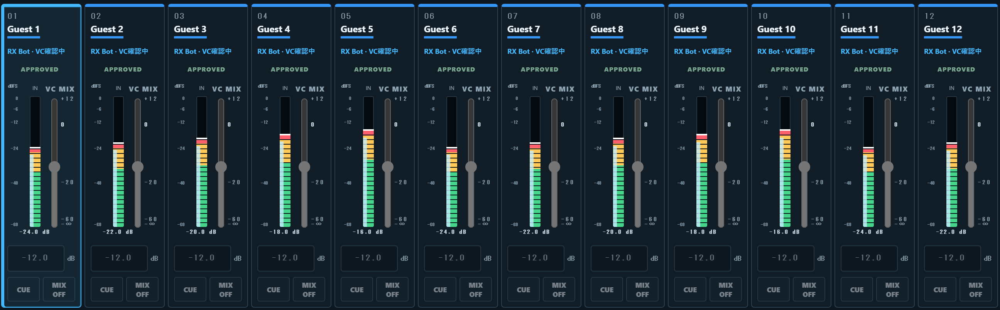
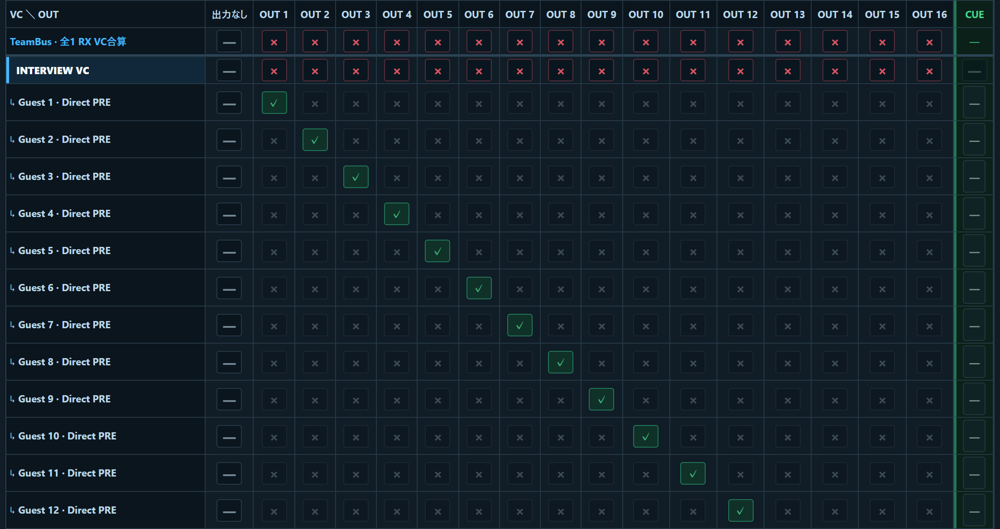

# ParaBus

**English** | [日本語](README.ja.md)

A Windows audio router for Discord. ParaBus receives voice per participant and per voice channel,
then mixes, records and outputs it to physical audio devices.
Main (program) and Cue (monitoring) can go to separate devices, and physical inputs can be sent back to Discord.

The control UI is in Japanese, with some headings in English.

> **Beta.** This is not a stable release and has not been proven in production.
> Read the [known issues and field checklist](docs/BETA.txt) first,
> and always keep a backup audio path. Do not use ParaBus as your only, untested broadcast path.
>
> - Long-running hardware tests after the diagnostic hook removal, UI cleanup, suspension of tablet support and dependency updates have not been performed.
> - The maintainer confirmed live Discord connection and audio send/receive with the beta.2 Windows ZIP, but only in a short test.
> - On Windows 11 PCs with Smart App Control on, the bundled unsigned audio DLLs may be blocked from loading, preventing startup. The maintainer confirmed this with beta.2 on 2026-10-27.
> - Check the status in **Windows Security → App & browser control → Smart App Control settings** ([Microsoft instructions](https://support.microsoft.com/en-us/windows/security/windows-security/app-browser-control-in-the-windows-security-app)). ParaBus currently has no workaround; code signing is being considered. Keep OS protection settings unchanged.
> - In beta.2, the tray says “初回導入が必要です” (initial installation required), but reinstalling does not resolve this block. In beta.3 and later, a detected app-control block has a separate notification.



## Features

- Receive and mix Discord audio per participant and per voice channel, with up to 24 RX bots, 22 TX bots and 24 bots in total per PC
- Route each participant's Direct Out to physical output channels
- Use separate Main / Cue devices, or route Cue to unused channels on the Main device
- Select ASIO / WASAPI audio devices and send physical inputs to Discord in mono or stereo
- Record selected Main Output channels, VC MIX and User / Input tracks as 48 kHz, 32-bit float mono WAV files
- Preview Scene changes before applying them, with Recall Safe protection
- Use emergency mute and browser controls, locally or from another PC on a trusted LAN



*Screenshots use demo data (24 test participants, mock output). No real Discord accounts are shown.*

Docs are currently in Japanese: [operator manual](docs/manual.html) (download and open it in a browser if GitHub shows it as code)
and [Discord bot setup](docs/DISCORD_RX.md).

## Download

**Windows x64 beta: [v0.1.0-beta.4](https://github.com/adilazkahadiko/ParaBus/releases/tag/v0.1.0-beta.4)**

[Download ParaBus-windows-x64-v0.1.0-beta.4.zip](https://github.com/adilazkahadiko/ParaBus/releases/download/v0.1.0-beta.4/ParaBus-windows-x64-v0.1.0-beta.4.zip) ·
[SHA256SUMS.txt](https://github.com/adilazkahadiko/ParaBus/releases/download/v0.1.0-beta.4/SHA256SUMS.txt)

The ZIP includes Node.js, corresponding source and third-party notices. Extract it into a new folder.

GitHub's "Source code (zip)" is the development source, not a runnable app.

## Requirements

- Windows x64 and the manufacturer's driver for your audio interface
- A Discord bot with the required permissions in the target voice channels ([setup](docs/DISCORD_RX.md))
- Source builds only: Node.js >= 22.23.4 and < 23, Rust and a native build toolchain

ParaBus is tested mainly on Windows. macOS launch and build scripts exist,
but macOS has not been verified on real hardware to the same level.

## Getting started

### Windows ZIP

Extract the ZIP into a new, dedicated folder and keep all bundled files together. Node.js is included.

Open `ParaBus.exe`, then open the control screen from the "PB" icon in the notification area.
If SmartScreen appears, confirm where the file came from, then choose "More info" → "Run anyway".

<details>
<summary>macOS test package</summary>

Double-click `ParaBus.app`. If a warning appears, close it, then allow the app in
System Settings → Privacy & Security → "Open Anyway" (「このまま開く」 on Japanese macOS), and double-click again.

The app is not signed or notarized by an Apple Developer ID. It removes the quarantine attribute only inside
the extracted folder and never disables Gatekeeper system-wide.

</details>

Do not run files from unknown sources, and do not disable OS-wide protection.
Never extract over an existing production folder.

### From source

Follow [installing from source](docs/SOURCE_RELEASE.md#ソースからの導入), then start with `start-router.cmd` (Windows)
or `start-router.command` (macOS).

### Connecting bots and shutting down

Bots start disconnected. Configure them in SETUP and press **接続** (Connect) for each bot.

To quit, use **SETUP → ParaBus を終了** on the PC running ParaBus. Settings lock must be off,
ParaBus must not be in FAULT, and recording must be stopped with all files saved. Closing the browser tab does not quit ParaBus,
and it cannot be shut down from another PC on the LAN.

## Updating

By default, settings and `.env` are stored in the app folder. Extracting a new version into a new folder
starts with an empty Bot list; settings from the old folder are not imported automatically.
Keep the old folder, including `.env`, settings and recordings, intact as a private backup.

If both versions provide these export/import controls, transfer Bot profiles using the UI on the PC running ParaBus:

1. In the old version, open **SETUP → BOTS** and choose **Bot設定を書き出し（Tokenなし）** (Export Bot settings without tokens).
   The exported JSON contains Bot names, roles and Server / VC IDs, but no tokens. Keep it private.
   Have each Bot's token available from your own secure records; ParaBus cannot display saved tokens again.
2. Quit the old version after recording has stopped and all files have been saved. Extract the new version into a new, dedicated folder.
   Never extract over the old production folder.
3. Open the new version and choose **SETUP → BOTS → Bot設定を読み込み** (Import Bot settings).
   Select the exported JSON and confirm the replacement of the editable Bot list. Importing does not save settings or connect bots.
4. Open **詳細** (Details) for each Bot, re-enter its token and check its role and Server / VC IDs, then press **設定を保存** (Save settings).
   Connect each Bot manually with **接続** (Connect) when ready.

This export transfers only Bot profiles. It does not transfer tokens, Scenes, audio devices, routing,
or application settings such as the port and LAN access. Set up devices and routing again using the
[operator manual](docs/manual.html), and lower the monitor volume before starting devices.
These steps assume the default storage location and do not use manual copies of `.env` or other settings files.

## Security and bug reports

- Never publish bot tokens, real settings, recordings or logs.
- Use the LAN control screen only on a trusted network. Do not port-forward it to the internet.
- Bug reports: include the version, OS, audio devices, steps to reproduce and the time it happened.
  If a report may contain confidential information, follow [SECURITY.md](SECURITY.md#reporting-a-vulnerability)
  and report privately through **Security → Report a vulnerability** instead of opening a public issue.
- For diagnostics, use a Support Bundle. Check its contents before sharing; do not attach the whole app folder,
  original settings or recordings.

## Development

Installing dependencies runs third-party code. Use a dedicated development folder, never a production one.
See [installing from source](docs/SOURCE_RELEASE.md#ソースからの導入) for setup and native builds,
[ASIO build](docs/ASIO_BUILD.md) for ASIO support, and [Linux development](docs/LINUX_DEV.md).

| Path | Contents |
| --- | --- |
| `services/` | Control UI, audio processing, Discord connection |
| `packages/` | Shared code such as inter-process communication |
| `crates/` | Rust device management, audio processing, Windows launcher |
| `tests/` | Automated tests, simulators, load tests |
| `tests/core-ipc/` | Integration tests against the Rust core |
| `scripts/`, `release/release-manifest.json` | Launch, build and packaging |
| `docs/` | Manuals, beta limitations, license texts |

```powershell
npm.cmd run typecheck      # TypeScript type check
npm.cmd test               # Node tests (excludes Rust integration)
npm.cmd run test:rust      # Rust unit tests
npm.cmd run test:core-ipc  # Build Rust, then run integration tests
```

Load tests and explicit hardware tests are not part of the regular test run.
Some internal package names and setting keys still use the former name "DBR".
Keep them for compatibility with existing settings; do not rename them for cosmetic reasons.

## AI in development

ParaBus is vibe-coded. Almost all of the code, tests and documentation were written by AI coding agents
(Codex and Claude Code) under the maintainer's direction.
The maintainer sets the goals, tests on real hardware and decides what gets released,
but does not review every line the way a professional audio or security engineer would.

Please keep that in mind: keep a backup audio path, and review the code yourself before relying on it in production.
Bug reports and fixes are welcome.

## License

Copyright (C) 2026 ParaBus contributors.

ParaBus is licensed under [GPL-3.0-only](LICENSE) and comes with no warranty.
Third-party code is covered by [its own licenses](THIRD_PARTY_NOTICES.md).

ParaBus — Developed by Adil Azka<br>
Built with Codex and Claude Code
